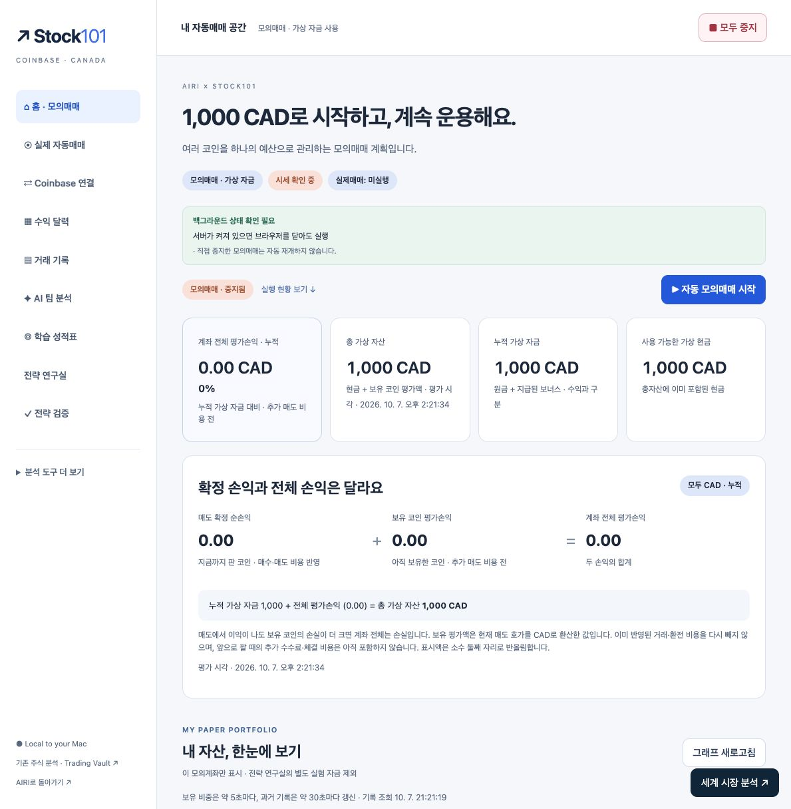
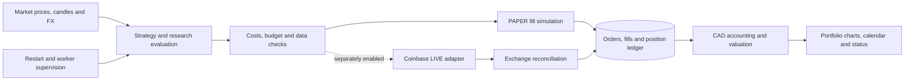

# Stock101

### AI-Assisted Trading Research & Portfolio Lab

A Coinbase-oriented trading research and paper-simulation workspace with multi-asset strategies, fee-aware CAD accounting, portfolio charts, audit records and optional agent research.

**Community source release · v0.1.2 · Python 3.11+ · Personal and noncommercial use**


*Actual clean PAPER workspace with example virtual capital of 1,000 CAD. Simulation is stopped;
there are no imported holdings, trades or demonstrated returns in this screenshot.*

## Why this exists

A trading dashboard needs to explain both its decisions and its accounting. Stock101 keeps
market inputs, strategy evaluation, execution state and portfolio records visible, with
separate PAPER and LIVE paths and clear differences between deposits, realized profit,
unrealized profit and total equity.

## Architecture at a glance



**Stack:** Python, SQLite, Decimal accounting, browser JavaScript/SVG, Coinbase market-data
adapters and optional LLM research. [Architecture and accounting walkthrough →](docs/ARCHITECTURE.md)

[](https://github.com/Lvstw1205/stock101/actions/workflows/checks.yml)

## What it does

- Multi-asset research with market data, strategy signals and forecasts.
- PAPER execution with durable orders, fills, positions and restart-aware workers.
- Fee, spread, slippage and FX-aware CAD accounting.
- Explicit labels for deposits, equity, realized and unrealized P&L.
- Portfolio allocation charts, equity history and daily realized P&L calendar.
- Strategy incubation, historical validation and optional TradingAgents research.
- Separately gated Coinbase live adapter with budget checks and reconciliation.
- Read-only Telegram status rendering for integration with AIRI Assistant.

## Quick start

macOS is the primary tested platform. Install Python 3.11+ and Git first. On Windows,
the standalone Vision/Stock101 Python host may run, but Windows packaging is not verified.
AIRI Assistant and Tim Works contain macOS/POSIX integrations.

```bash
git clone https://github.com/Lvstw1205/stock101.git
cd stock101
bash scripts/setup.sh
.venv/bin/python run.py
```

Open **http://127.0.0.1:8767** in your browser. On macOS you can also double-click
`Start.command` after downloading and extracting the source archive.

The initial screen has no imported account or trading history. Review the PAPER settings
and start simulation explicitly. Public market data works without a Coinbase secret;
availability depends on the exchange and network. The example budget is 1,000 CAD with
recurring contributions disabled. Settings are local and editable.

LIVE starts disabled. Adding a key does not automatically start orders. See
[connection and execution modes](docs/TRADING.md). No live orders were placed during
release verification. Results, forecasts and profitability are not guaranteed.

## Data and operation

Your records are created in `data/`; downloaded models use `.runtime/` or `web/hand-assets/`.
These paths are excluded from Git. Nothing from the original owner's accounts, recordings,
conversations, credentials, face enrollments or trading ledgers is included.

The service runs while its Python process and computer are awake. Closing the browser does
not stop the server. Optional macOS login startup is installed with
`.venv/bin/python scripts/install_autostart.py`; use `--remove` to uninstall that launcher.
This is login startup, not execution while powered off. Keep the extracted folder in place.

## Public release history

This project was developed locally before its public release. The public repository starts
with a sanitized source import on **7 October 2026**; private records and the original
working history are not included. Subsequent fixes and documentation changes are recorded
as ordinary commits. The import date is not a claim that all development happened that day.

## Documentation

- [Architecture and code walkthrough](docs/ARCHITECTURE.md)
- [한국어 시작 안내](README.ko.md)
- [Setup and troubleshooting](docs/SETUP.md)
- [Privacy and data handling](PRIVACY.md)
- [Security reporting](SECURITY.md)
- [Release validation](docs/VALIDATION.md)
- [Third-party notices](THIRD_PARTY_NOTICES.md)

## License

Original code is **source-available under [PolyForm Noncommercial 1.0.0](LICENSE.md)**.
Personal and noncommercial use, modification and redistribution are subject to those terms.
Commercial use requires separate permission from the rights holder. This is not an
OSI-approved open-source license. Third-party code and models retain their own licenses.
Required attribution is in [NOTICE](NOTICE).

## Related projects

[AIRI Assistant](https://github.com/Lvstw1205/airi-assistant) ·
[AIRI Vision](https://github.com/Lvstw1205/airi-vision) ·
[Stock101](https://github.com/Lvstw1205/stock101) ·
[AIRI Playbook](https://github.com/Lvstw1205/airi-playbook) ·
[Tim Works Beta](https://github.com/Lvstw1205/tim-works-beta) ·
[AIRI Unhinged Voice](https://github.com/Lvstw1205/airi-unhinged-voice)
